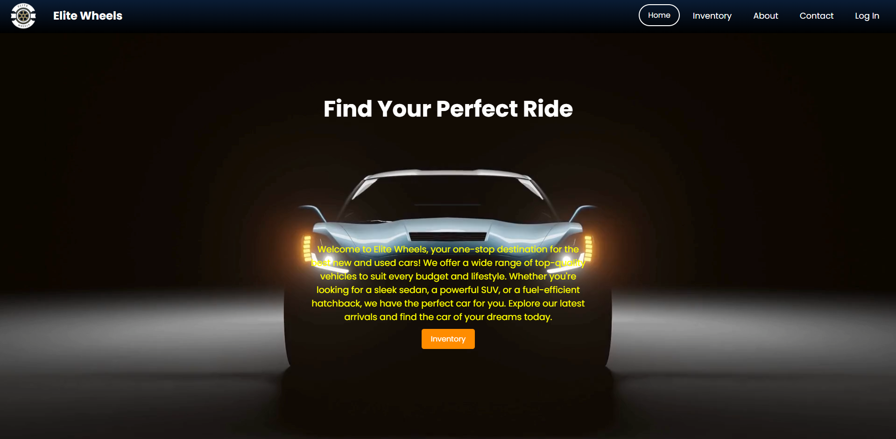
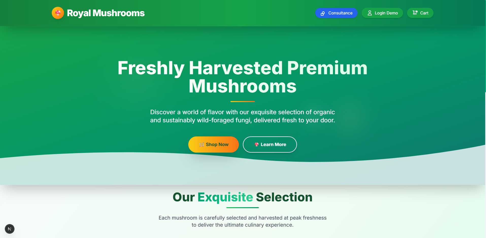

 

  
  
  

---

<h3 align="center">👋 About Me</h3>

  🎓 Information Systems student at <strong>Sabaragamuwa University of Sri Lanka</strong> 
  🔍 Exploring digital forensics, AI systems, and software architecture 
  💻 Building interfaces, APIs, and practical tools 
  🤝 Open to collaboration and learning from other developers

---

<h3 align="center">🛠️ Tech Stack &amp; Tools</h3>

<strong>Languages</strong>

  &nbsp;
  &nbsp;
  &nbsp;
  &nbsp;
  &nbsp;
  &nbsp;
  

<strong>Frameworks &amp; Libraries</strong>

  &nbsp;
  &nbsp;
  &nbsp;
  &nbsp;
  

<strong>Data &amp; Development</strong>

  &nbsp;
  &nbsp;
  &nbsp;
  &nbsp;
  

---

<h3 align="center">🔥 GitHub Analytics</h3>

  
  

  

  

Language share measures code size across my public, non-fork repositories; it does not measure proficiency. Snapshot: 24 October 2026.

<strong>JavaScript 51.6%</strong> · TypeScript 20.6% · Python 9.8% · CSS 8.5% · Java 5.0% · HTML 3.2% · PHP 0.9% · Other 0.4%

---

<h3 align="center">🚀 Featured Projects</h3>

<table width="100%">
  <tr>
    <td width="50%" align="center">
       
      Document analysis using error level analysis, noise variance, and metadata inspection.
    </td>
    <td width="50%" align="center">
       
      Fleet operations with Spring Boot, React, vehicle records, dispatch, and reporting.
    </td>
  </tr>
  <tr>
    <td width="50%" align="center">
       
      Luxury car rental interface built with Next.js and TypeScript.
    </td>
    <td width="50%" align="center">
       
      Mushroom storefront with a product catalog, cart, and account pages.
    </td>
  </tr>
  <tr>
    <td width="50%" align="center">
       
      Scam detection for freelance messages and job listings.
    </td>
    <td width="50%" align="center">
       
      Chess explanations grounded in engine analysis.
    </td>
  </tr>
</table>

  
<strong>See interface screenshots</strong>

   
  <table width="100%">
    <tr>
      <td width="50%" align="center"> Elite Wheels</td>
      <td width="50%" align="center"> Royal Mushrooms</td>
    </tr>
  </table>

---

Connect through <a href="https://www.linkedin.com/in/ravindu-wanasinghe/">LinkedIn</a> or visit my <a href="https://ravinduwanasinghe0524.github.io/">portfolio</a>.

